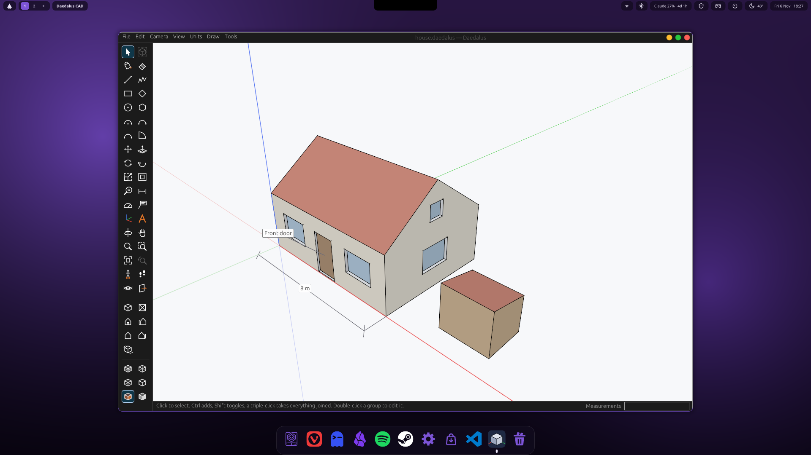
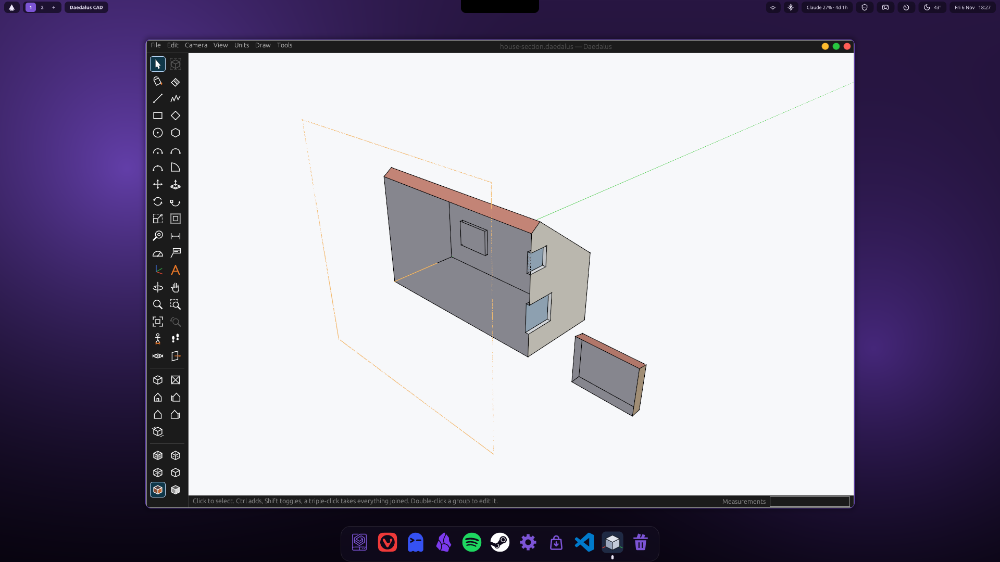
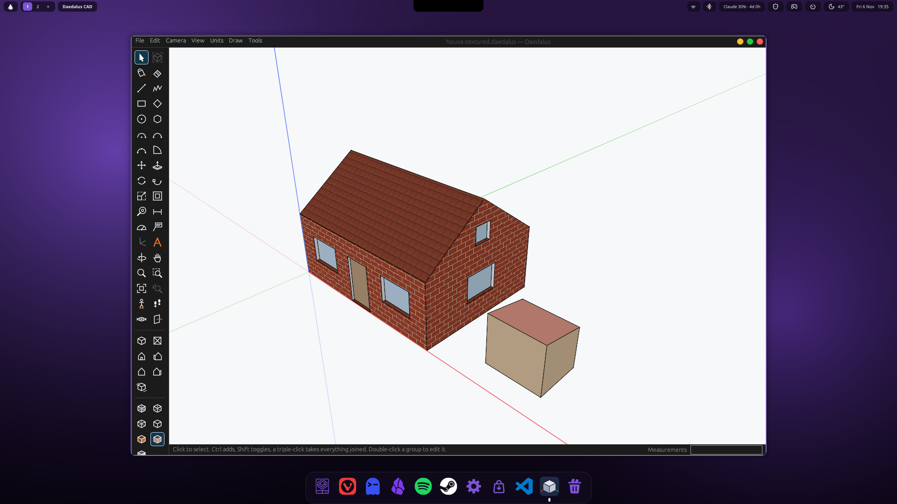
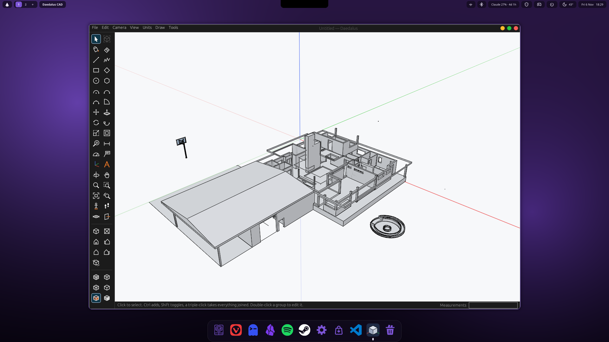

# Daedalus CAD

A SketchUp-style modeler in Rust, built from first principles (no code derived from other applications).



## Goals
One multi-purpose CAD tool: SketchUp-style 3D modeling for buildings and layouts, top-down 2D
drafting, and mechanical part design including sheet metal (flat patterns and bend lines for
laser/waterjet and bending services). SketchUp's tools and controls are the model for the UX.

## Layout
- `daedalus-core`: `Mesh` (interchange), `HalfEdgeMesh` (topology checks, normals, `split_face`,
  `push_pull`, `erase_face`), `Model` (document with atomic undo/redo), `sketch` (workplanes,
  rectangle, circle, polygon) and `triangulate` (ear clipping for concave faces)
- `daedalus-io`: format importers/exporters behind `MeshImporter` / `MeshExporter`
- `daedalus-app`: CLI that prints mesh stats
- `daedalus-viewer`: the modeler (wgpu + egui). `cargo run -p daedalus-viewer [-- model.stl]`

## Using the modeler
Laid out like SketchUp: menus and toolbar on top, hints and the Measurements box at the bottom.

| Tool | Key | Use |
|---|---|---|
| Select | Space | click a face, an edge or a line (Ctrl adds, Shift toggles); drag a box: left to right takes what is wholly inside, right to left what it touches (Ctrl+Shift takes out); Delete erases it |
| Line | L | click corners; click the start point to close the loop into a face |
| Rectangle | R | two corners, or type `width,height` after the first |
| Circle | C | centre, then radius (click or type); type `24s` to set segments |
| Polygon | | centre, then radius; type `6s` to set sides |
| Push/Pull | P | click a face, move, click; or type a distance. Typing again right after re-does it |
| Eraser | E | click a face |
| Orbit / Pan (Hand) / Zoom | O / H / Z | left-drag with the tool; Shift+Z zooms to extents |

- Mouse: middle-drag orbits, Shift+middle-drag (or right-drag) pans, the wheel zooms toward the cursor.
- Typing digits goes straight into the Measurements box; Enter applies, Esc clears or cancels.
- Points snap to endpoints and midpoints; lines lock to the red/green axes within 3 degrees.
  Shapes are drawn on the face under the first click, or on the ground.
- Camera menu: Top, Iso, Parallel Projection. Ctrl+Z / Ctrl+Y undo and redo.
- `I` inspects the solid, Tools > Repair Solid repairs it (`F` is Offset, as in SketchUp). Imports with non-manifold topology open read-only until repaired.
- Groups and components: select faces (a triple-click takes a whole object) and use Edit > Make Group, or Make Component
  (`G`). Double-click one to edit inside it (the rest fades); click outside it or press Esc to close it. Copies of a
  component change together; Edit > Make Unique separates one. Edit > Explode turns it back into loose geometry.
- Move copies when Ctrl is tapped during the move; type `x5` right after for five copies in a row, or `/5` to divide the
  distance.
- Text: click what it points at, then where it goes, and type. 3D Text: type the words, height and depth, then click a face
  or the ground. Axes: pick a new origin, red and green direction; Tools > Reset Axes.

## Solid inspector
Checks whether a model is a valid solid (open borders, non-manifold edges, flipped or inverted
faces, duplicate and zero-area faces, short edges, stray vertices) and repairs what it can.
```sh
cargo run -p daedalus-app -- inspect model.stl                 # report; exit code 1 if not a solid
cargo run -p daedalus-app -- inspect model.stl --fix fixed.stl # repair and write
```
In the viewer press `I` to inspect (problem faces turn red) and use Tools > Repair Solid to repair.

## Sheet metal flat patterns
```sh
# L-bracket: 50 and 30 outside flanges, one 90 degree bend with 2.0 inside radius, 2 mm sheet
cargo run -p daedalus-app -- flatten bracket.dxf --thickness 2 --k 0.44 --width 40 50 90:2 30
```
Writes a 1:1 DXF with the outline on layer `CUT` and a line at the centre of each bend on layer
`BEND`. K-factor and bend radius come from your fabricator for the material and thickness.
Flange lengths are outside dimensions; use a negative angle for a bend down.

## Building on Arch Linux
```sh
sudo pacman -S --needed base-devel git rustup vulkan-icd-loader mesa libxkbcommon wayland libx11 libxcursor libxrandr libxi
# plus a Vulkan driver for your GPU: vulkan-radeon, vulkan-intel or nvidia-utils
rustup default stable
cargo run -p daedalus-viewer
```
**On Labyrinth OS** Daedalus CAD is in Agora, the app store (Create > 3D & CAD): one click installs the signed build from
Labyrinth's package repository (`daedalus-cad-git`: `daedalus` and `daedalus-cli`, with the application-menu entry and icon from
`packaging/`), and Agora's updates keep it current.

To install it for your user (binary in `~/.local/bin/daedalus`, plus an application-menu entry and icon):
```sh
packaging/install.sh              # run again after `git pull` to update
packaging/install.sh --uninstall
```
winit loads the X11/Wayland libraries at runtime, so the viewer runs on either session type.
The workspace is pure Rust with no C build dependencies beyond a linker (`base-devel`).
CI (`.github/workflows/ci.yml`) builds and tests on Arch and Windows.

## Roadmap
Behavior targets come from the publicly documented feature set of other free modelers
(for example IngeTrazo, GPL-3.0). Daedalus is designed and written independently;
no source from those projects is used.

1. Drawing: line, rectangle, circle, polygon, arc; edge splitting of faces; inference and axis locks (done)
2. Value-box entry of exact lengths; repeat-last-command (done)
3. Modify: move, rotate, scale, offset, follow-me, eraser (done); hide (not yet)
4. Groups and components (shared definitions) (done); layers, scenes (not yet)
5. Materials and styles, edge rendering, section planes (done)
6. Solid operations (union, subtract, intersect) and a watertightness guard (done: Solid Tools, Solid Inspector)
7. Native save format (done), SKP read (done, through `skp-convert` instead of the SDK), glTF export (not yet)
8. Sheet layout with vector PDF/DXF output (not yet; sheet-metal flat patterns already go to DXF)
9. Sheet metal in the model and STEP export (done)
10. Stress testing (FEA), next

## Format status
| Format | Status | Notes |
|---|---|---|
| STL, OBJ | import + export | hand-written parsers |
| DXF | import + export | ASCII only; `3DFACE` and polyface meshes |
| DAE | import + export | triangles, polylist, polygons; no materials or transforms |
| JPEG/PNG/TIFF/BMP/DIB | load | `image` crate |
| PSD | load | flattened composite only (`psd` crate) |
| PDF | todo | `pdfium-render` needs the pdfium library at runtime |
| FBX | todo | `fbxcel` |
| Daedalus (`.ddls`) | open + save | native, keeps everything: plain text, versioned (version 6 holds sheet-metal parts); `.daedalus`, its earlier name, still opens and saves under its own name |
| SKP | import | through `tools/skp-convert` (OpenSKP, installed apart), which writes `.dskp` for Daedalus to read |
| STEP (`.step`, `.stp`) | read (flat faces) + write | what new models are saved as. AP214, our own reader and writer (`daedalus-io/src/step.rs`, from the standard): every face a plane with its holes, closed shells as solids and the rest as surfaces, loose lines as wireframe, soft edges in an invisible "Soft edges" layer, groups and components as an assembly (each written once), colours, units. Curved faces (cylinders, B-splines...) are named, not read yet. File > Export STEP for Fabrication writes sheet-metal parts exact (AP242, `daedalus-sheet`) |
| DWG | todo | LibreDWG is GPLv3, so isolate in an optional crate |
| F3D/F3Z/CAM360 | blocked | no public spec; use STEP instead |
| RBZ | later | needs a reimplementation of the public SketchUp Ruby API |

## Coplanar faces
As in SketchUp, neighbouring faces that lie in one plane are one face: pushing a face of a solid again leaves no seam, and
Repair (Tools > Repair Solid) turns an imported mesh's triangle pairs back into the faces they were drawn as. Tools > Merge Coplanar Faces does
it by hand. A group whose outline would have a hole is left as it is until faces with holes are supported.

## Toolbar
Icons in SketchUp's manner (a pencil for Line, a red box with an arrow for Push/Pull, the red and green orbit arrows), each
with its name and shortcut on hover. View > Toolbar puts the toolbar across the top or down the left side; the choice is
remembered.

## Units
The Units menu shows and takes lengths in millimetres, centimetres, metres, inches, or feet and inches (to 1/16"). A bare number
is in the chosen unit; a unit written after it always wins, so `300mm`, `1.2m`, `6"`, `4'` or `4' 6 1/2"` work whatever is shown.
The choice is remembered (`~/.config/daedalus/settings.conf`). The model itself is kept in metres.



A section plane cuts the model open to look inside; the cut is filled and outlined.



Paint Bucket paints colours or textures (any JPEG, PNG or BMP image, tiled across the face at a size set in Entity Info);
View > Shaded with Textures shows them.

## SketchUp files
SketchUp models (`.skp`) open with File > Open, groups and components kept, through the `skp-convert` helper (see the
licence notes below). Here a house modelled in SketchUp, opened in Daedalus:



## Saving
Files are meant to be shared, so they should not need Daedalus to be opened. File > Save (Ctrl+S) keeps the format a model
was opened in when Daedalus writes it (STEP, `.ddls`, OBJ, STL, DAE, DXF) and writes the file in place, with no dialog; a
`.daedalus` file is saved back under its own name. A new model asks where, with STEP chosen to start with; `.ddls` (keeps
everything), OBJ, STL, DAE and DXF are offered too. A SketchUp model (`.skp`, or `.dskp`) is saved beside itself as STEP,
never over the `.skp`, and so is a STEP file Daedalus read only in part (curved faces); after that, Save goes to the file
chosen. When the format cannot hold everything, a notice says what was left out (STEP: notes, textures, Dynamic Component
formulas, sheet-metal steps; STL: groups and components, colours, lines, the faces' shapes, the unit, and so on), with a
button to save a full `.ddls` copy beside it too. File > Export STEP for Fabrication is something else: exact solids for a
shop (sheet-metal parts with true bends), leaving out what is not a closed solid.

`.ddls` is Daedalus's own file: plain text (`v x y z` per vertex, `f` and vertex numbers per face) with a version on the
first line, so it is readable, diffable and kept bit-exact. It holds lines, colours, groups and components, guides,
dimensions, text, the section plane, the drawing axes, textures, Dynamic Components and sheet-metal parts. Opening a STEP
file takes its length unit; what Daedalus does not read yet (curved faces) is named in a notice. Open, Save As, Import
(STEP, STL, OBJ, DXF, DAE) and Export use the desktop's own file dialog (Minos on the Yggdrasil desktop), or a file browser
built into the window where there is none. The title shows a dot while there are unsaved changes, and New, Open, Import or
closing the window asks before throwing them away.

The demo models in these pictures are drawn by `cargo run -p daedalus-io --example demo_models -- FOLDER`, with the same
calls the tools make.

## Next
Stress testing (FEA) first, then more sheet metal (jogs) and the Dynamic Components extras.

## License

MPL-2.0 (see `LICENSE`), like Labyrinth OS's other from-scratch projects. Daedalus is written independently; no source from other
modelers is used.

SketchUp models (`.skp`) open through the `skp-convert` helper (`tools/skp-convert`), which reads them with
[OpenSKP](https://github.com/iamahsanmehmood/openskp) (MIT, Ahsan Mehmood); OpenSKP is installed apart from Daedalus and
not part of its build.

3D Text draws its letters from Ubuntu Light, the font the egui toolkit already carries (via `epaint_default_fonts`), under
the Ubuntu Font Licence 1.0, which allows it to be embedded and shipped with a program; its outlines are read with
`ttf-parser` (MIT/Apache-2.0).
